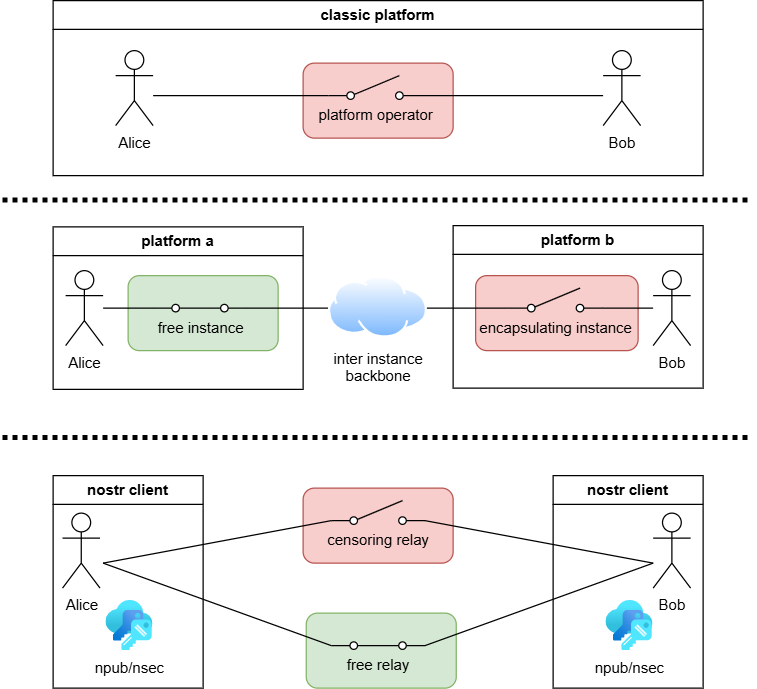

# Brezn

> **Try the [live browser demo](https://dabena.github.io/Brezn/)**

Brezn is a Nostr client that shows posts from your **local** area.
Your position is reduced to a five-character geohash (roughly 5 x 5 km cells, depending on latitude). On geotagged root posts Brezn publishes that coarse cell as public `g` tags (full cell plus shorter prefixes), not raw GPS coordinates. Replies get no `g` tags; they remain public notes, just without location tags. The cell is still public and lasting, so treat it as location data. More detail: [PRIVACY.md](PRIVACY.md) / [DATENSCHUTZ.md](DATENSCHUTZ.md).
Set how wide the feed looks by adjusting geohash query length (shorter = larger area). Lengths 1-5 query that cell and its eight neighbors; length 0 is a global geotagged feed over all one-character `#g` prefixes.
Like CB radio for the internet: free, equal, and decentralized.

## Installation

[Brezn](https://dabena.github.io/Brezn/) can be installed as a Progressive Web App (PWA) and then runs like a native app:

- **Android**: Use the browser banner "Add to Home Screen" or go to Menu -> "Add to Home Screen".
  Alternatively, download the latest [APK](https://github.com/dabena/Brezn/releases/latest).
- **iOS**: In Safari tap Share -> "Add to Home Screen".
- **Tor Browser:** Open Brezn as a normal tab if you want relays not to receive your home IP. A PWA from Chrome/Edge/Safari/normal Firefox exposes your real IP; Desktop Tor Browser is not a normal PWA install browser, a shortcut only helps if it opens inside Tor Browser. Keep the relay list short. Keys live in that Tor Browser profile - New Identity or quitting typically clears them. Details: [PRIVACY.md](PRIVACY.md) / [DATENSCHUTZ.md](DATENSCHUTZ.md).

After a PWA install, Brezn appears with its own icon on your home screen and opens as a standalone app without browser chrome.

## What is Nostr?

[Notes and Other Stuff Transmitted by Relays](https://github.com/nostr-protocol/nostr) is an open, decentralized protocol for social networking.
Events are stored and distributed by many independent relays. Different Nostr apps speak the same protocol and can access the same content.
Your identity consists of a key pair (npub/nsec) and is not bound to a server or app. If a relay goes down, you can use others without losing your identity; content you already published stays available only where relays still keep a copy.

## Network Architectures Compared



- **Classic social networks**: Everything runs through one centrally controlled company server.
- **Federated networks** (e.g. mail, Mastodon, Matrix): Multiple servers that talk to each other. Each server can enforce its own rules and block other servers.
- **Nostr**: Clients connect to multiple relays simultaneously. Relays do **not** talk to each other. Communication runs through clients. If you publish to several relays, a single relay refusing an event does not stop you.

## What does Brezn do?

Brezn is a client for the existing Nostr protocol with a focus on local, location-based feeds using geohash tags and **not** its own social network.
With the same keys and relays you can see the same content on other Nostr clients.

Before media upload, Brezn tries **best effort** to strip identifying metadata from images and videos. Images are re-encoded in [`compressImage`](src/lib/mediaUpload.ts); MP4/MOV containers are cleaned in [`stripMp4Metadata.ts`](src/lib/stripMp4Metadata.ts). Composer uploads run that path from [`ComposerSheet.tsx`](src/components/ComposerSheet.tsx). Until you change it in Settings, uploads go to a built-in default NIP-96 host.

Relays and media hosts you connect to receive an IP address. Built-in default relays and the default media host are bootstrapping only (easier first run), not a recommendation - change them in Settings. If you want relays not to receive your home IP, open Brezn in [Tor Browser](https://www.torproject.org/download/) and read on in section 8: **[PRIVACY.md](PRIVACY.md#8-tor-browser)** (English) / **[DATENSCHUTZ.md](DATENSCHUTZ.md#8-tor-browser)** (Deutsch).

## Tech Stack

- `React` + `Vite`
- `Tailwind CSS`
- `@nostr-dev-kit/ndk`
- `vite-plugin-pwa`

## Development

Requires **Node.js 24+**

```bash
npm install
npm run dev        # Start development server
npm run build      # Production build
npm run preview    # Preview production build
npm run lint       # Run linter
npm run format     # Format with Prettier
npm run test       # Run tests
```

**GitHub Pages**: deployment on push to `main` via [`.github/workflows/deploy-pages.yml`](.github/workflows/deploy-pages.yml)

## Acknowledgments

Many thanks to the developers of the dependencies and operators of public Nostr relays who make all of this possible.

## Legal stuff

Brezn is a client for the Nostr network. The publisher does not host your posts, does not operate relays, and does not run a backend that stores your feed content.

**Bootstrapping:** Default relays and the default media host ship with the client only until you change them - not as an endorsement.

**Third parties:** When you use the app, your browser talks to relays, media hosts and (if you open the map) map tile providers. Those operators receive connection data such as IP and store content under their own policies. Your secret key stays in IndexedDB on this device (AES-GCM with a non-extractable wrap key, or an optional password). Other app settings stay in browser storage on your device. Web builds are hosted on GitHub Pages; access data there is handled under GitHub's [Privacy Statement](https://docs.github.com/en/site-policy/privacy-policies/github-privacy-statement).

**No warranties:** Brezn is free software without a promise of anonymity or uptime.

**Filtering and reports:** Brezn offers optional client-side filtering (keyword mute, pubkey block). If you add a report reason when blocking, Brezn sends a NIP-56 report event to your relays. That report event is a protocol notice, not publisher moderation or enforcement. Whether operators store or act on it is up to them. Relay operators are volunteers. Treat them with respect.

**Keys and deletion:** You are responsible for your private keys and what you publish. NIP-09 deletion from the client is only a non-binding request to relays. Content may remain on the network indefinitely and cannot be guaranteed deleted.

[Legal notice](https://mein.online-impressum.de/dabena/) / [Privacy](PRIVACY.md) / [Datenschutz](DATENSCHUTZ.md) / [License](LICENSE)
